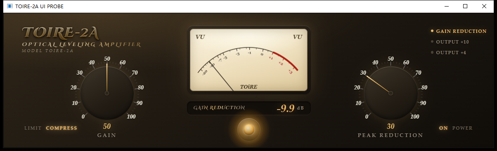

# TOiRE-2A

一个用 JUCE 8 写的 **Teletronix LA-2A 光电压缩器**模拟插件（VST3 / Standalone，64 位 Windows）。
界面用 **WebView2** 渲染，DSP 用行为模型拟合 **UAD LA-2A** 的实测数据。



---

## 它是什么

LA-2A 是 1960 年代的光电压缩器，核心是一个 **T4 光电池**（CdS 光敏电阻 + EL 发光面板）。
它的声音特点是：

- **只有两个旋钮** —— Peak Reduction（压缩量）和 Gain（补偿增益）
- **反馈式拓扑** —— 侧链取的是压缩后的信号，所以压缩特性是"自适应"的
- **柔软、粘连、有呼吸感** —— 光学元件的惯性带来的

这个插件试图复现这些行为，而不是简单地挂一个压缩器。

---

## 功能

### 控件

| 控件 | 作用 |
|---|---|
| **PEAK REDUCTION** | 压缩量（对应真机 0–100 刻度） |
| **GAIN** | 补偿增益（逐点实测的非线性曲线） |
| **GAIN REDUCTION / OUTPUT +10 / OUTPUT +4** | 表头三档（点行切换） |
| **COMPRESS / LIMIT** | 视觉装饰（DSP 里暂无对应参数） |
| **ON / POWER** | **真实的 bypass**（逐采样直通，已验证误差 0） |
| **T4 呼吸灯** | 亮度跟随 GR，静息时缓慢呼吸 |

### 隐藏参数（DAW 里可见、可自动化）

| 参数 | 范围 | 默认 | 说明 |
|---|---|---|---|
| `meterAttack` | 5–300 ms | **62** | 表头起针 |
| `meterRelease` | 30–2000 ms | **110** | 表头回落 |
| `meterMode` | 0/1/2 | 0 | GR / Output+10 / Output+4 |
| `bypass` | on/off | off | 旁路 |

---

## 安装

### 用安装包（推荐）

从 [Releases](../../releases) 下载 `TOIRE-2A-1.0.0-win64.exe`，双击安装。

```
安装到 : C:\Program Files\Common Files\VST3\TOIRE-2A.vst3
需要   : Windows 10 1809+ / 64 位
依赖   : Microsoft Edge WebView2（安装程序会自动检测并安装）
```

装完在 DAW 里点一次"重新扫描插件"即可。

> 想试装到别处而不影响正式安装：
> `TOIRE-2A-1.0.0-win64.exe /DIR="D:\test\TOIRE-2A.vst3" /CURRENTUSER`

### 卸载

控制面板 → 程序和功能 → **TOIRE-2A 1.0.0 (VST3)**。
只删 `...\VST3\TOIRE-2A.vst3` 这一个文件夹。

用户数据（`%APPDATA%\TOiRE-2A`，WebView2 的缓存）**不会**被删除 —— 需要的话手动清理。

---

## 从源码构建

### 依赖

- **Visual Studio 2026**（MSVC 19.51）
- **CMake ≥ 3.22**
- **JUCE 8.0.7**，放在 `../JUCE`
- **WebView2 SDK**（NuGet 包 `Microsoft.Web.WebView2`）

### 命令

```bat
cmake --preset vs2026
cmake --build build --config Release
```

产物：

```
build\TOIRE2A_artefacts\Release\VST3\TOIRE-2A.vst3
build\TOIRE2A_artefacts\Release\Standalone\TOIRE-2A.exe
```

> ⚠️ 构建前必须清掉代理环境变量，否则 MSVC 可能报 `MSB6001`：
> ```powershell
> Remove-Item Env:HTTP_PROXY,Env:https_proxy,Env:ALL_PROXY,Env:NO_PROXY -ErrorAction SilentlyContinue
> ```

### 关闭 WebView2 前端（回到原生 UI）

```bat
cmake -B build -S . -DTOIRE2A_WEBVIEW2=OFF
```

### VSCode

仓库自带 `.vscode/` 和 `scripts/`：

| 操作 | 方式 |
|---|---|
| 构建 | `Ctrl+Shift+B` |
| 其它任务 | `Ctrl+Shift+P` → `Tasks: Run Task` |
| 调试 | `F5` |

> 坑：VSCode 默认终端是 PowerShell，而 `vcvarsall.bat` 是 cmd 语法。
> 所以构建逻辑全部放进了 `scripts/*.bat`，任务只负责调用脚本。

---

## 打包安装包

```powershell
powershell -ExecutionPolicy Bypass -File installer\build-installer.ps1
```

产物：`dist\TOIRE-2A-<version>-win64.exe` + `dist\SHA256-installer.txt`

`installer/deps/` 里需要放两个文件（不入库）：

```
MicrosoftEdgeWebview2Setup.exe    WebView2 引导程序
ChineseSimplified.isl             安装向导的中文语言文件
```

---

## 架构

```
LA2ACompressor     纯 DSP，不 include 任何 UI 头
      │
      ▼ UiTelemetry
   UiBridge        无锁（std::atomic），唯一的 DSP → UI 出口
      │
      ├──▶ 原生 Editor（JUCE 控件，可用 -DTOIRE2A_WEBVIEW2=OFF 切换）
      └──▶ WebView Editor（本仓库默认，1188×329）
```

**换前端只需要改 `PluginProcessor::createEditor()` 里的一行。**

### 目录

```
src/
  DSP/LA2ACompressor.h/.cpp    T4 行为模型（光电池 + 反馈环 + 饱和）
  Bridge/UiBridge.h            DSP → UI 无锁遥测
  PluginProcessor.h/.cpp       参数、processBlock
  PluginEditor.h/.cpp          原生 UI + WebView UI
  UI/LA2AKnobLookAndFeel.h     原生旋钮外观

WebUI/                         WebView2 前端（纯 HTML/CSS/JS，ES5，零依赖）
  index.html
  style.css
  app.js                       旋钮交互 + VU 表 canvas 绘制
  juce-bridge.js               C++ ↔ JS 通信层
  fonts/                       Cinzel Decorative（OFL，本地化，不走 CDN）

installer/                     Inno Setup 6 打包脚本
```

---

## DSP 校准

模型参数不是猜的，是**逐项对 UAD LA-2A 实测**拟合出来的。

### 关键结论

| 项目 | 结果 |
|---|---|
| **静态曲线**（全 Peak 稳态扫描） | 最大误差 **≤ 0.61 dB** |
| **释放曲线**（500 ms 过载后） | 全程 **≤ 0.36 dB** |
| **Attack**（1–20 ms） | **≤ 0.25 dB** |
| **谐波** H2–H5（工作区间） | 平均 **3.4 dB** |
| **Bypass** | 逐采样直通，误差 **0.000e+00** |
| **GR 包络相关度**（真实素材） | **0.967** |

### 几个反直觉的发现

1. **释放不是指数衰减，是双曲的** —— `GR ∝ 1/t`，即 `τ = A/GR^1.8 + 45ms`。
   用单指数拟合 RMS 会差 4.7 倍。

2. **饱和接近硬限幅**（n ≈ 30），不是 tanh —— 这才是 UAD 那种
   "压缩不多但 THD 很高" 的来源。

3. **侧链取在 makeup 之前** —— 这就是手册说"Gain 不影响压缩"的原因。
   取在后面是一个真实的 bug，会让 Gain 25 时压缩量差 7 dB。

4. **静态求解对反馈环无效** —— 斜率 > 1 所以定点不稳定，
   实际行为由滤波器惯性决定，必须逐采样仿真。

### 已知偏差

- **高电平素材（母带成品，RMS ≈ −9 dBFS）压缩量浅约 2 dB**
  分轨混音电平下（−20 ~ −14 dBFS RMS）误差在 1 dB 内。
  根因是反馈环的静态斜率上限 `k/(1+k) < 1`，而真实光电池有电荷累积。
- **COMPRESS / LIMIT 是纯视觉** —— DSP 里没有对应参数。

---

## 许可与致谢

- **JUCE** —— GPL / 商业双许可，见 [juce.com](https://juce.com)
- **Cinzel Decorative** —— SIL Open Font License 1.1，本地化打包（不走 CDN）
- LA-2A / Teletronix 是 Universal Audio 的商标。
  本插件是**独立的算法研究项目**，与 Universal Audio 无关联，也未使用其任何代码或模型。

---

## 状态

**1.0.0** —— 可用于分轨混音。
DAW 兼容性测试过：Cubase / Nuendo / Fender Studio Pro / Reaper。
